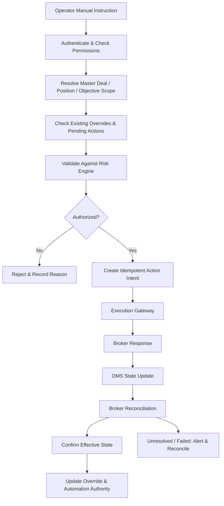
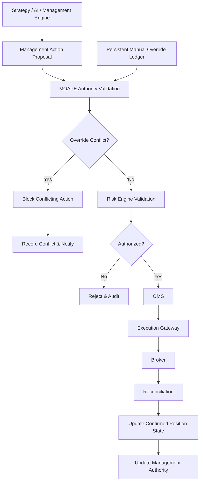
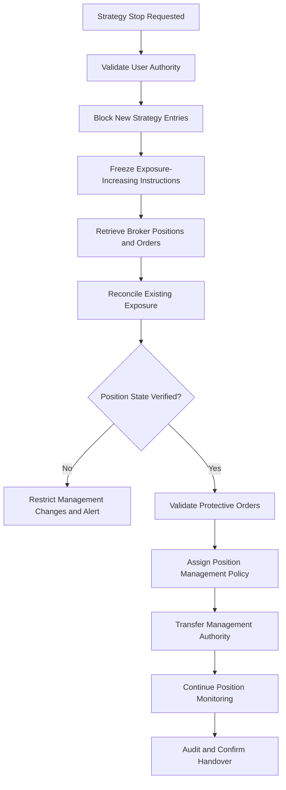
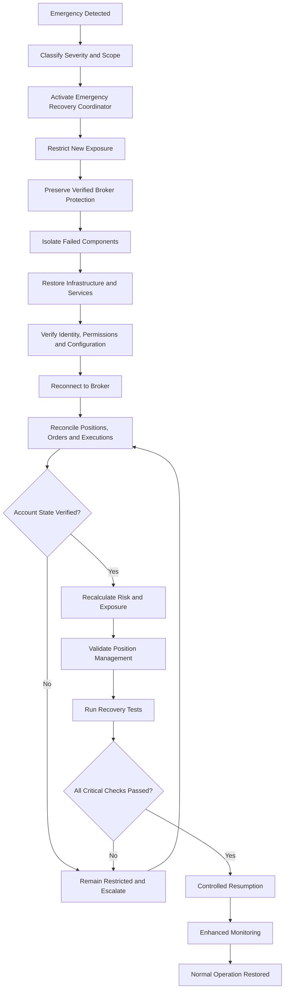
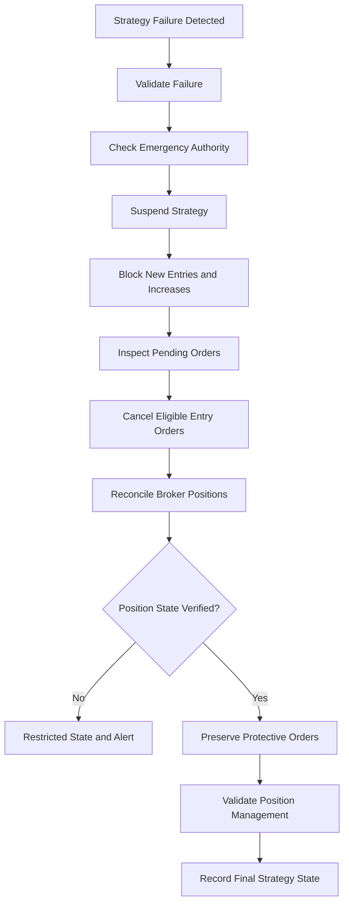
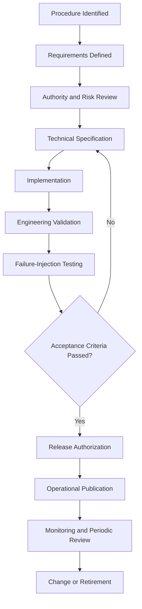
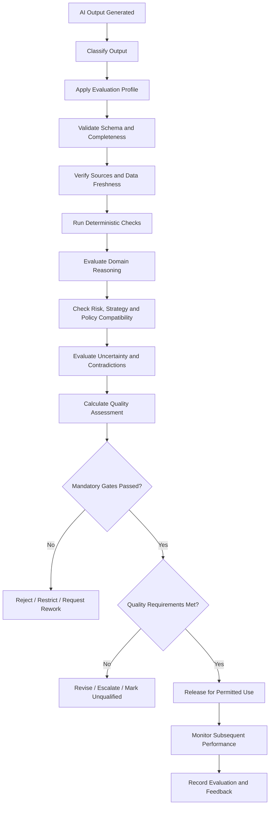
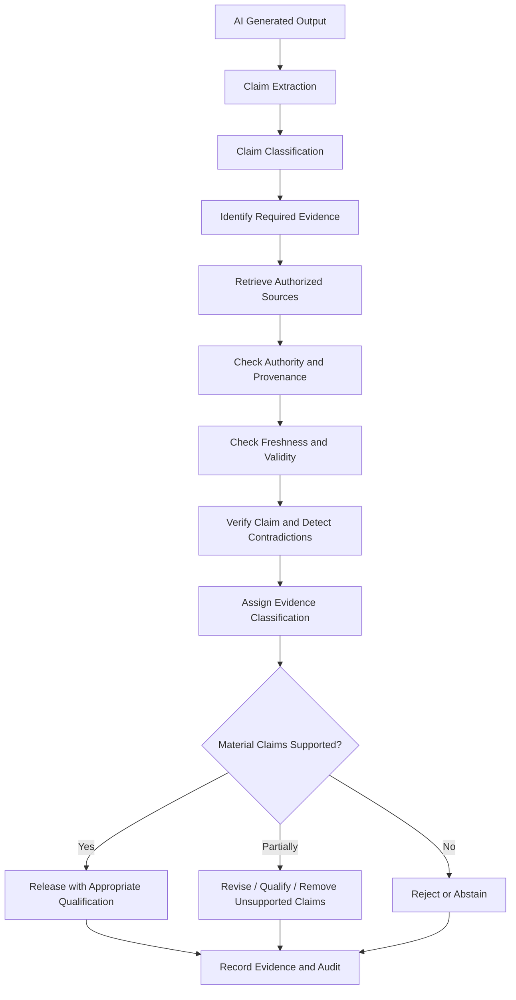
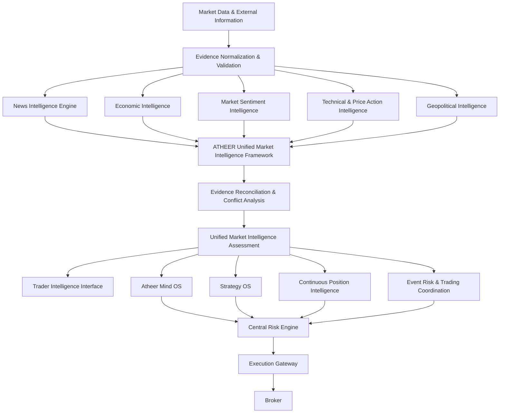
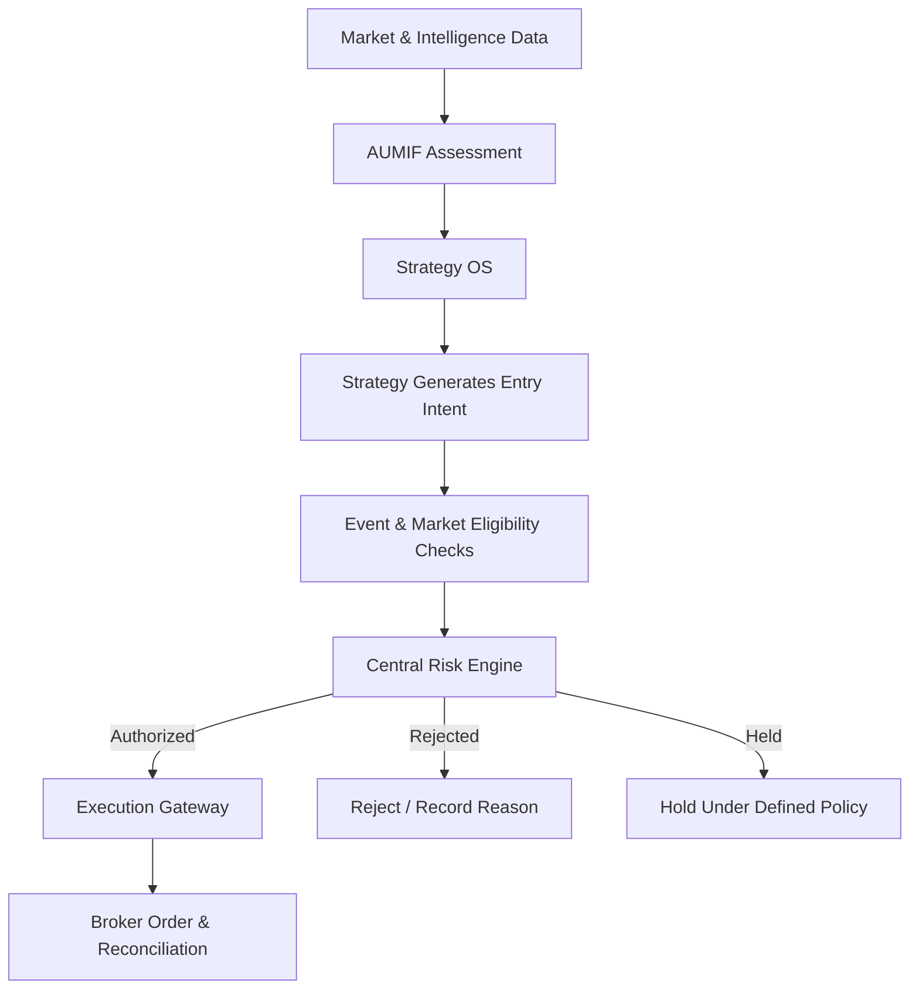

# ATHEER Governing Trading and Intelligence Flows

**Source:** ChatGPT Library — `Atheer Q&A Repository.zip`, 12 fenced Mermaid source blocks inspected on 2026-11-18; the flows below are normalized engineering transcriptions and consolidations.  
**Purpose:** Preserve owner-provided workflow diagrams in the engineering repository so implementation, tests, recovery procedures, and agent behavior can refer to the same governing flows.  
**Authority note:** These normalized diagrams preserve the source workflows' control points and intent; they are not byte-for-byte reproductions and do not prove that the corresponding product modules are implemented. Requirements and implementation status remain tracked separately.

## 1. Manual intervention in automated trades

**Source question:** PART VII — Automated Trading & Strategy Engineering / Section 23 — Advanced Trade Management / Q11 — Can a user manually intervene in automated trades?

**Engineering invariants**
- Manual intervention is authenticated and permission-scoped.
- It resolves the master deal/position/objective and checks existing overrides and pending actions before creating intent.
- Risk Engine authorization precedes the Execution Gateway.
- The OMS records broker responses and reconciliation confirms effective state.
- Unresolved/failed outcomes alert and reconcile; they do not authorize blind duplicate submission.

## 2. Prevent strategies from overriding approved manual adjustments

**Source question:** PART VII — Automated Trading & Strategy Engineering / Section 23 / Q13 — How can the strategy be prevented from overriding approved manual adjustments?

**Engineering invariants**
- The persistent manual override ledger is consulted before management authority is granted.
- A conflicting strategy/AI proposal is blocked before risk authorization.
- The approved path remains Risk Engine → OMS → Execution Gateway → Broker → Reconciliation.
- Only confirmed position state may update management authority.

## 3. Stop a strategy without closing its positions

**Source question:** PART VIII — Risk Management & Capital Protection / Section 26 — Risk Events & Emergency Operations / Q26.14 — Is it possible to stop strategies without closing the positions?

**Engineering invariants**
- Stopping a strategy is not equivalent to closing its positions.
- New entries and exposure-increasing instructions are blocked first.
- Existing broker positions and orders are retrieved and reconciled.
- Protective orders and position-management policy are validated before authority transfer.
- If position state is unverified, management changes remain restricted and an alert is raised.

## 4. Emergency recovery procedure

**Source question:** PART VIII — Risk Management & Capital Protection / Section 26 / Q26.15 — Is there an Emergency Recovery Procedure?

**Engineering invariants**
- Recovery begins by restricting new exposure and preserving verified broker protection.
- Infrastructure restoration does not prove broker/account state recovery.
- Identity, permissions, and configuration are revalidated before reconnecting.
- Positions, orders, and executions are reconciled before risk recalculation.
- Any unverified account state remains restricted and escalated.
- Resumption is controlled and followed by enhanced monitoring.

## 5. Emergency procedure lifecycle and qualification

**Source question:** PART VIII — Risk Management & Capital Protection / Section 26 / Q26.17 — How is each emergency procedure documented?

### Strategy failure response

### Procedure design and acceptance

## 6. AI output quality and evidence qualification

**Source questions:** PART IX — AI, AGENTS & INTELLIGENCE SYSTEM / Section 27 — AI Architecture / Q27.14 and Q27.15.

### Output quality gates

### Unsupported-claim detection

**Engineering invariants**
- Agent output is evidence-qualified, provenance-aware, and freshness-checked.
- Deterministic checks and risk/strategy policy compatibility are mandatory gates.
- Unsupported material claims are revised, qualified, removed, or rejected—not presented as verified facts.
- AI output does not bypass the central Risk Engine or Execution Gateway.

## 7. Unified market intelligence to governed execution

**Source:** PART X — News, Economic Events & Geopolitical Intelligence / Section 30 — News Intelligence.

### Unified intelligence assessment

### Strategy entry authorization

## 8. Application to the current engineering stack

These diagrams are used as acceptance constraints, not claims of completed functionality:

1. **IPC/process supervision:** restart and health probes establish process availability only; broker identity and account state still require verification and reconciliation.
2. **Broker Session Manager:** must be the sole owner of authenticated session lifecycle, account switching, REST keepalive, streaming subscriptions, and disconnect/reconnect state.
3. **OMS and Execution Gateway:** all manual and automated financial actions must use one idempotent, centrally risk-authorized path.
4. **Risk Engine:** no AI, strategy, workspace, manual UI, or recovery workflow may bypass risk authorization.
5. **Recovery:** do not resume new exposure until broker orders, positions, executions, protective orders, and account state are reconciled and critical recovery tests pass.
6. **AI:** conclusions and trade proposals must carry evidence provenance, freshness, uncertainty, and policy compatibility.

Current status remains tracked in `TASK_REGISTER.md`, `IMPLEMENTATION_STATUS.md`, and `ENGINEERING_DECISION_LOG.md`. The diagrams do not imply that OMS, Risk Engine, Execution Gateway, Broker Session Manager, or live broker reconciliation are complete.
