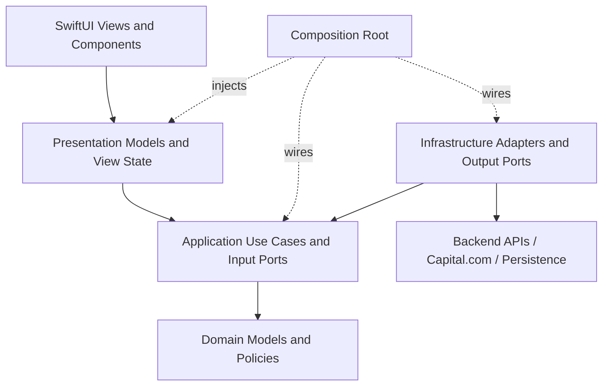

# ATP-UI-ARCH-001 — Presentation Architecture and Backend Decoupling

- **Document ID:** ATP-UI-ARCH-001
- **Version:** 1.0
- **Status:** Owner-directed architecture baseline; detailed implementation and conformance are pending.
- **Scope:** Native ATHEER Trading Pro macOS application and future presentation clients.
- **Governing sources:** Root `AGENTS.md`, repository architecture and engineering policies, owner-directed Premium Professional Trading Workspace design direction, and accepted domain/security/trading constraints.
- **Related document:** [ATP-UI-DS-001 — Premium Professional Trading Workspace Design System](ATP-UI-DS-001.md)

## 1. Purpose

Define enforceable boundaries that let ATHEER screens evolve independently of backend services, broker providers, transport protocols, and persistence schemas. This document governs dependency direction, presentation contracts, composition, state mapping, testing, and architecture review.

The goal is not abstraction for its own sake. Introduce an interface or model when it protects a real boundary, enables independent testing/substitution, or prevents a known source of change from propagating into unrelated layers.

## 2. Architectural outcomes

1. A visual redesign, layout change, navigation change, or component replacement does not require backend changes unless it introduces a genuinely new capability or changes domain semantics.
2. Backend API or provider-schema changes are localized to infrastructure adapters, decoders, and contract tests.
3. SwiftUI views consume stable presentation state and send user intents; they do not know HTTP, JSON payload shapes, broker SDKs, database records, or transport error codes.
4. Domain and application policies remain independent of SwiftUI and external providers.
5. Services and providers are replaceable through explicit composition and dependency injection.
6. Financial truth, provenance, data quality, authorization, and trading safety are preserved across mappings.

## 3. Required dependency model

The intended logical flow is:

Dependency direction must point inward toward stable application/domain policy. Infrastructure implements output ports defined by the inner application boundary. The composition root is the only place that selects concrete implementations and assembles the graph.

This diagram describes the target architecture, not a claim that all layers or modules currently exist.

### 3.1 Presentation

Owns:
- SwiftUI screens, navigation composition, reusable UI components, accessibility semantics, and screen-specific view state.
- Presentation models tailored to a screen or reusable presentation capability.
- Formatting and display transformations that do not alter financial/domain meaning.
- Translation of user gestures/actions into application input commands.

Must not own:
- HTTP requests, URL construction, JSON decoding, API DTOs, Capital.com wire models, persistence records, broker SDK clients, or financial authorization.
- Trading calculations or risk decisions that belong to domain/application policy.
- Construction of concrete infrastructure clients in Views or ViewModels.

### 3.2 Application

Owns:
- Use cases and orchestration of user-facing workflows.
- Input ports for operations requested by presentation.
- Output ports for required external capabilities.
- Application-level coordination, cancellation, and workflow outcomes.
- Mapping orchestration between domain results and presentation-facing results where that responsibility belongs to the application boundary.

Application contracts must express capabilities and business intent, not HTTP routes or provider-specific payloads.

### 3.3 Domain

Owns:
- Provider-independent trading concepts and invariants.
- Financial semantics, value objects, identity, units, timestamps, provenance, and quality semantics where they are part of domain meaning.
- Deterministic policies and calculations.

Domain must not import SwiftUI, URLSession, JSON libraries, Capital.com SDKs, backend DTOs, or UI formatting concerns.

### 3.4 Infrastructure and integration

Owns:
- HTTP/WebSocket transport, serialization, API DTOs, provider-specific identifiers and payloads, persistence adapters, retries, and transport-level diagnostics.
- Provider/API contract decoding and validation.
- Mapping external representations into application/domain contracts.
- Mapping provider errors into stable application-level failure categories while retaining safe diagnostic context.

Infrastructure must not leak its wire models or transport-specific errors through public presentation contracts.

### 3.5 Composition root

Owns:
- Construction and lifetime of concrete adapters, use cases, stores, and presentation models.
- Environment/configuration selection and dependency wiring.
- Explicit separation of DEMO, SIMULATION, BACKTEST, and LIVE dependencies.

A screen or ViewModel must not silently instantiate its production network dependency. Preview/test construction is allowed through explicit fixtures and must never be used as a production fallback.

## 4. Contract and model ownership

| Contract/model | Owner | May be referenced by |
|---|---|---|
| API/transport DTO | Infrastructure | Decoder, adapter, contract tests |
| Persistence record | Infrastructure | Repository implementation and persistence tests |
| Domain entity/value object | Domain | Application and permitted presentation mapping |
| Application input/output port | Application | Presentation caller; infrastructure implementation |
| Use-case result/failure | Application | Presentation mapping |
| Presentation model/view state | Presentation | SwiftUI views and presentation tests |
| Design token/component API | Design System | Presentation components and screens |

Rules:
- Never pass an API DTO directly into a SwiftUI View, ViewModel, or screen state.
- Never make a domain entity mirror an external JSON schema solely for decoding convenience.
- Keep screen-specific display needs in presentation models; do not pollute domain models with UI-only flags, localized labels, colors, or formatted strings.
- Do not create duplicate domain and presentation models when there is no meaningful boundary or transformation. Prefer a deliberate mapping point over mechanical one-to-one wrappers.
- Keep provider identity and provenance where needed to preserve meaning, but represent them through stable domain concepts rather than raw response envelopes.
- Preserve Bid and Ask as distinct price sides. Do not synthesize Mid or exchange volume unless an approved domain rule and source semantics explicitly support it.

## 5. Presentation state and failure semantics

Presentation state must communicate user-relevant meaning rather than expose provider implementation details. Common states include:
- idle / not configured
- loading
- loaded / current
- empty
- stale
- partial
- unavailable
- permission required / unauthorized
- failed / recoverable
- failed / non-recoverable
- submitting / accepted / rejected / pending confirmation, where a workflow requires them

State sets should be specific to the screen/workflow; do not add unused universal states. A transport timeout, HTTP 503, provider rejection, decoding failure, or local cancellation may map to different stable semantic outcomes. Preserve a correlation/reference identifier and safe diagnostic details where operational support requires them, without presenting raw payloads or secrets to users.

Market-data presentation must preserve source/provider, environment, instrument identity, price side, event time, receipt time, freshness, and quality metadata whenever relevant to interpreting the value. Never substitute fabricated data when data is missing, stale, or unavailable.

## 6. Dependency injection and lifecycle

- Define narrow interfaces around capabilities actually consumed by a use case.
- Inject dependencies through initializers or an explicit composition mechanism.
- Construct concrete URLSession/backend/broker/persistence adapters at the composition root.
- ViewModels may own presentation state and coordinate use-case calls; they must not become service locators or create hidden production dependencies.
- Avoid global mutable service registries and ambient singletons for business dependencies.
- Make cancellation, task lifetime, duplicate-request suppression, stale-result suppression, and error recovery explicit for asynchronous workflows.
- Keep preview/test fixtures deterministic and isolated from production configuration.
- Avoid speculative generic repositories, service locators, protocol-per-type patterns, and unnecessary wrapper layers.

## 7. UI and trading safety boundary

The UI is an intent source and an information surface, not an execution authority.

- No view, ViewModel, chart component, strategy screen, or AI panel may call broker dealing endpoints directly.
- Manual, strategy-generated, and AI-originated order intents must converge on the same governed order-intake and risk-authorization path.
- RiskEngine and Execution Gateway authority cannot be replicated or bypassed in presentation.
- UI confirmation is not a substitute for backend authorization, risk validation, idempotency, or broker reconciliation.
- Distinguish DEMO, SIMULATION, BACKTEST, and LIVE visibly and semantically. Never infer environment from styling alone.
- Keep `CAP_ALLOW_TRADING=false` until the separately defined DEMO reconciliation and risk-gateway gates are satisfied. LIVE requires explicit owner authorization and risk acknowledgement.
- Display broker-confirmed financial state as authoritative. Do not present optimistic local state as a broker-confirmed fill, position, balance, or order.

## 8. Design-system boundary

The Design System is a presentation-layer capability:
- Tokens define visual roles and scales; they must not import market-data, broker, risk, or backend modules.
- Components accept semantic values and explicit actions, not service clients or API DTOs.
- Components must not own trading policy or infer financial meaning from color.
- Theme changes and component redesigns must not require application/backend changes.
- See ATP-UI-DS-001 for the visual language, tokens, component patterns, accessibility, and visual acceptance rules.

## 9. Testing strategy

| Test layer | Required evidence |
|---|---|
| Infrastructure contract tests | Representative provider payloads, malformed payloads, schema drift, timestamp/quality invariants |
| Adapter/mapping tests | External DTO → domain/application mapping, error translation, provenance preservation |
| Domain tests | Financial invariants and deterministic policy behavior independent of UI/network |
| Use-case tests | Workflow outcomes using test doubles for output ports |
| Presentation-model tests | Semantic state mapping, formatting, stale/partial/empty/error behavior |
| View tests | Important interaction, navigation, accessibility identifiers/labels, state rendering |
| Visual QA | Screenshots at agreed window sizes, appearance modes, density, and workspace configurations |
| Architecture checks | No forbidden imports or dependency edges from Presentation into Infrastructure |

Tests must not require a live broker account or production credentials. Contract fixtures must be sanitized and must not contain secrets or personal account data.

## 10. Migration and adoption sequence

1. Inventory current screens, ViewModels, services, DTOs, and dependency construction.
2. Draw the actual dependency graph and classify every exposed model by ownership.
3. Select one bounded vertical slice (initial candidates: Chart Workspace or Market Explorer) as the reference migration.
4. Introduce only the missing application port, mapping boundary, and presentation model required by that slice.
5. Move concrete infrastructure construction to the composition root.
6. Add contract, mapping, presentation-state, and interaction tests.
7. Verify behavior parity and preserve current data/safety invariants.
8. Review the pattern before applying it to other screens.
9. Track exceptions and migration debt explicitly; do not perform a broad speculative rewrite.

Do not block independent backend/market-data engineering where contracts are stable and the UI boundary is not being crossed. Do block new presentation dependencies that deepen coupling.

## 11. Pull Request architecture review checklist

A PR that changes UI, ViewModels, services, or API contracts must answer the relevant items:

- [ ] Are changed types located in the layer that owns their semantics?
- [ ] Do SwiftUI views and ViewModels avoid API DTOs, raw payloads, transport errors, and broker SDK types?
- [ ] Are new dependencies injected rather than constructed inside presentation code?
- [ ] Are application ports capability-oriented and provider-independent?
- [ ] Are external DTOs mapped and validated at the infrastructure boundary?
- [ ] Are domain invariants and financial semantics preserved?
- [ ] Are loading, empty, stale, partial, unavailable, permission, cancellation, and error states handled where applicable?
- [ ] Are DEMO/SIM/BACKTEST/LIVE boundaries preserved?
- [ ] Does any financial intent still pass through centralized risk and execution controls?
- [ ] Are deterministic tests added at the appropriate boundaries?
- [ ] Can a visual/layout change be made without modifying backend contracts?
- [ ] Are new abstractions justified by a concrete boundary and responsibility?

A checked box requires code/test evidence in the PR; a documentation assertion alone is insufficient.

## 12. Exceptions and change control

Any intentional dependency-boundary exception must be narrow, documented in the PR, justified by a concrete constraint, and assigned a follow-up/removal condition. Exceptions must not permit direct broker dealing, risk bypass, secret exposure, or production data fabrication.

This document is a governing engineering baseline for new and modified presentation work. Existing code is not declared conformant merely by publication; conformance is established through inventory, bounded migration, and review evidence.

## 13. References

- [Repository engineering instructions](../../AGENTS.md)
- [Repository architecture](REPOSITORY_ARCHITECTURE.md)
- [Repository layout](REPOSITORY_LAYOUT.md)
- [Apple Human Interface Guidelines](https://developer.apple.com/design/human-interface-guidelines/)
- [Apple — Designing for macOS](https://developer.apple.com/design/human-interface-guidelines/designing-for-macos)
- [Apple — Layout](https://developer.apple.com/design/human-interface-guidelines/layout)
