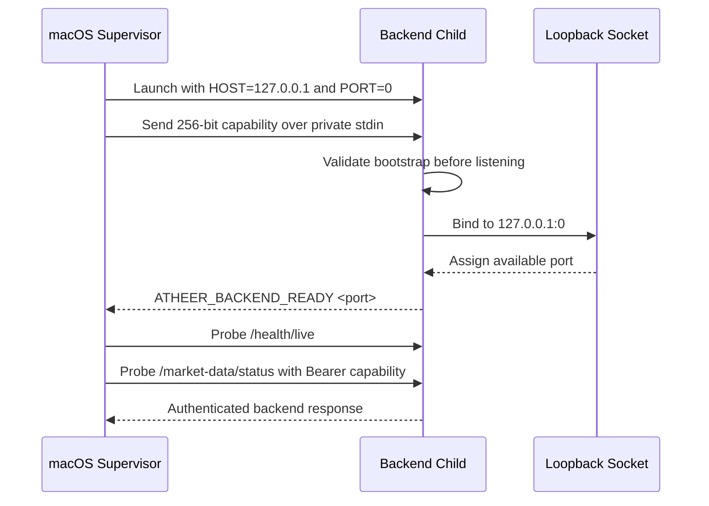

# SESSION 047 — Backend Ephemeral Port and Supervisor Readiness Contract

**Date:** 2026-11-18  
**Implementation PR:** [#52](https://github.com/atheertrading/atheer-trading-platform/pull/52)  
**Implementation branch:** `feat/backend-ephemeral-port-readiness`  
**Parent:** PR #51 head `1e312352696bcc5e18ba00a15dc426d37aa26c5a`  
**Task:** ATP-BRK-002 / EDL-025

## Implementation

- Runtime configuration accepts `PORT=0`, allowing the operating system to allocate an available loopback port instead of requiring the fixed developer port 4100.
- The API remains bound exclusively to `127.0.0.1`; non-loopback host configuration remains rejected.
- After the server successfully binds, the backend emits `ATHEER_BACKEND_READY <assigned-port>` on stdout.
- The readiness marker contains no capability, credential, broker session token, or other secret.
- The default developer port remains 4100.
- Existing private-stdin capability bootstrap and Bearer authentication remain unchanged.

## Supervisor sequence

The startup marker proves only that the child bound its socket. The native supervisor must still verify process liveness and an authenticated broker-market-data route before publishing a usable connection.

## Library diagram alignment

The implementation preserves the Library's execution-uncertainty and emergency-recovery principles: a process restart is not proof of restored broker state. Recovery must re-establish identity and permissions, reconnect only through the backend session authority, reconcile broker orders/positions/executions, and remain restricted when the account state is uncertain. The Q&A archive's manual-intervention workflow likewise routes authorized actions through Risk Engine, OMS, Execution Gateway, broker response, and reconciliation.

## Verification

- Added deterministic tests for the default port, ephemeral port `0`, invalid ports, and loopback-only host enforcement.
- PR #52 exact-head hosted CI is pending.
- No local Xcode build, owner-Mac process launch, or authenticated Capital.com DEMO session is claimed.

## Remaining ATP-BRK-002 work

- Native Swift `BackendProcessSupervisor`.
- Per-launch capability generation using the macOS Security framework.
- Authenticated Swift market-data client.
- Process lifecycle, restart, cancellation, and failure-injection tests.
- Bundled, pinned, architecture-matched Node runtime and compiled API assets.
- Keychain-backed broker credential handoff and one backend Broker Session Manager.
- Exact-head Intel/Apple Silicon CI and owner-Mac runtime/Keychain qualification.

No broker credentials, dealing endpoints, or LIVE endpoints were used. Trading remains disabled.
