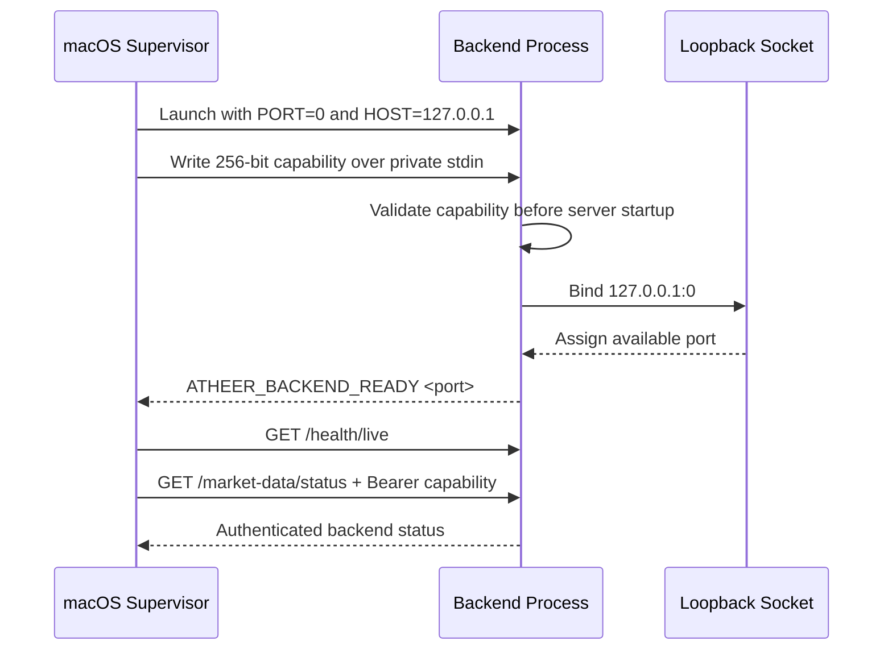

# SESSION 047 — Backend Ephemeral Port and Supervisor Readiness Contract

**Date:** 2026-11-18  
**Branch:** `feat/backend-ephemeral-port-readiness`  
**Parent:** PR #51 head `1e312352696bcc5e18ba00a15dc426d37aa26c5a`  
**Scope:** ATP-BRK-002 — managed native backend process bootstrap

## Purpose

Prepare the backend for a native macOS process supervisor without relying on a fixed loopback port. A fixed port can collide with another local process and does not provide a reliable way for the parent application to identify the child process endpoint.

## Implementation

- Runtime configuration now accepts `PORT=0`, allowing the operating system to allocate an available port.
- The API remains bound exclusively to `127.0.0.1`; non-loopback host configuration remains rejected.
- After the HTTP server has successfully bound, the backend emits one machine-readable line:
  `ATHEER_BACKEND_READY <assigned-port>`
- The readiness line contains no capability, broker credential, session token, or other secret.
- The existing private-stdin 256-bit IPC capability bootstrap and Bearer authorization boundary are unchanged.
- The default developer port remains `4100`.

## Process-supervision contract

The readiness marker proves only that the child has bound its loopback socket. The native supervisor must still verify process liveness and make an authenticated request before publishing a usable backend connection.

## Verification

- Added deterministic configuration coverage for the default port, OS-assigned port `0`, malformed/out-of-range ports, and loopback-only host enforcement.
- Backend CI, exact-head tests, and macOS process-supervisor integration are pending.
- No local Xcode build or owner-Mac process launch is claimed.

## Safety and limitations

- No broker credentials or real Capital.com DEMO session were used.
- No broker dealing, order, position mutation, or LIVE capability was added.
- `CAP_ALLOW_TRADING=false` remains the required operating state.
- This is the backend half of the process-supervision contract only. The Swift supervisor, app-side capability generation, authenticated market-data client, packaged Node runtime/API assets, and child lifecycle tests remain pending.

## Next implementation increment

Implement the native `BackendProcessSupervisor` and authenticated market-data client on top of this startup contract. Package a pinned, architecture-matched Node runtime and compiled API assets into the app bundle before claiming standalone app launch.
