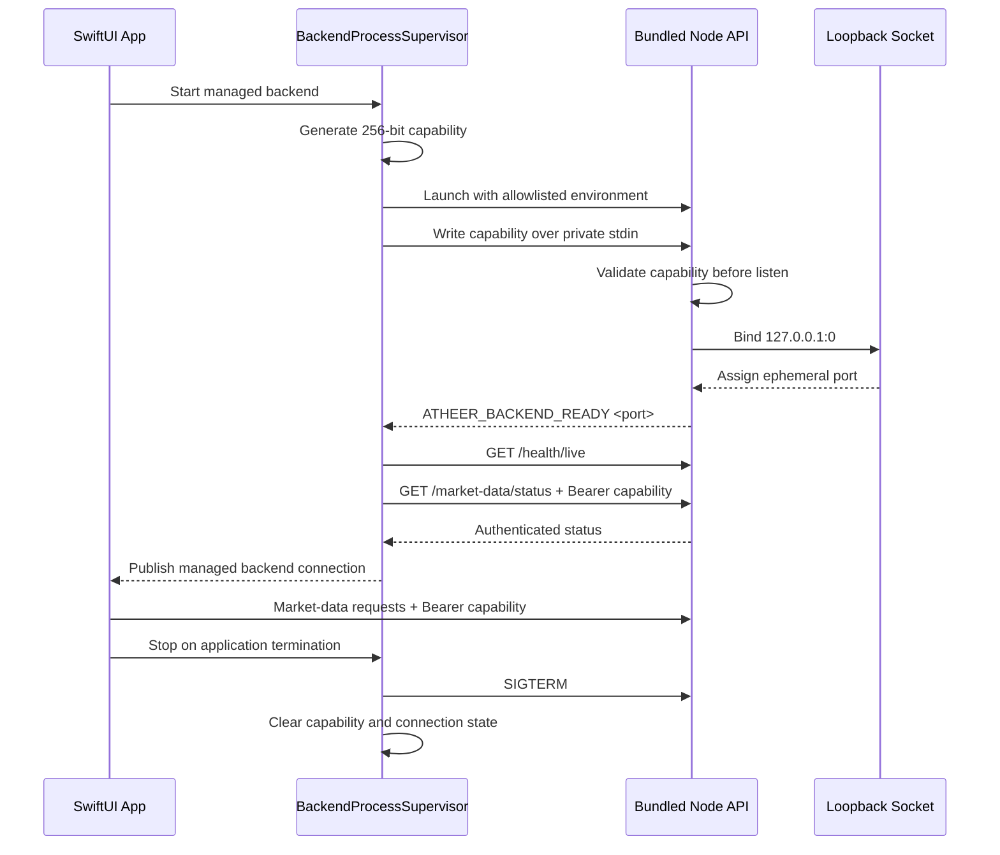

# SESSION 048 — Native macOS Backend Supervision and Authenticated IPC

**Date:** 2026-11-18  
**Implementation PR:** [#53](https://github.com/atheertrading/atheer-trading-platform/pull/53)  
**Implementation branch:** `feat/macos-managed-backend-runtime`  
**Stack:** PR #53 → PR #52 → PR #51 → `main`  
**Task:** ATP-BRK-002 / EDL-025

## Delivered implementation

- Added a Swift `BackendProcessSupervisor` that resolves packaged runtime assets, generates a cryptographically random 256-bit capability with `SecRandomCopyBytes`, launches the child process, and sends the capability through private stdin.
- The child receives only an allowlisted environment: loopback host, ephemeral port, production Node mode, and `CAP_ALLOW_TRADING=false`. Broker credentials are not inherited from the parent environment.
- The supervisor consumes `ATHEER_BACKEND_READY <port>`, probes `/health/live`, and then probes `/market-data/status` with the Bearer capability before publishing the connection.
- The supervisor handles startup timeout, child termination, stale termination callbacks, capability clearing, and app shutdown.
- `URLSessionMarketSearchClient` now requires the managed connection and attaches the Bearer capability to every market-data request. The unauthenticated default client path has been removed.
- `BackendHealthClient` accepts the OS-assigned backend URL.
- The application composition root starts the backend and presents a retry/diagnostics state if runtime startup fails. App termination requests a controlled child-process stop.

## Runtime packaging

- Pinned Node.js to **24.22.3**.
- The packaging script downloads the official macOS x64 and arm64 archives, verifies both against pinned SHA-256 digests, creates a universal Node executable with `lipo`, includes the Node license, and packages the compiled API into the app resources.
- XcodeGen includes the generated `Backend` and `Runtime` resource folders. `make generate` packages the backend before project generation; macOS CI performs the same step.
- Official Node.js 24 macOS binaries require macOS 13.5 or later. The app deployment target remains 13.0, but the supervisor fails explicitly below 13.5 rather than attempting an unsupported child runtime. The previously recorded owner Mac version 13.7.8 satisfies this runtime floor.
- Official references: https://nodejs.org/en/blog/release/v24.22.3 and https://nodejs.org/en/blog/migrations/v22-to-v24

## Process and IPC lifecycle

## Library workflow alignment

The Q&A archive's Mermaid workflows for manual intervention, manual-override authority, execution uncertainty, and emergency recovery remain governing constraints. A backend restart or successful process probe does not establish broker-account recovery. Any future financial action must still pass authority checks, the central Risk Engine, OMS, Execution Gateway, and broker reconciliation. An uncertain broker outcome must not trigger an automatic duplicate submission.

## Verification and CI findings

- Swift tests cover canonical 256-bit base64url capability formatting/clearing and strict readiness-port parsing.
- Existing Market Search HTTP tests now assert the Bearer header on status and instrument-search requests.
- Added a backend child-process integration test for stdin bootstrap, ephemeral loopback bind, health, unauthenticated rejection, and authenticated access.
- PR #52 CI run `44271151574` exposed missing local TypeScript declarations for `process.stdout.write` and `process.exitCode`; fixed on the PR #52 branch in commit `426b3a9c2541d719c2aaa2f02003709ece2e1f22`. The rerun is pending.
- PR #53 exact-head CI is pending. No local Xcode build or owner-Mac launch is claimed.

## Explicitly not completed

- No Capital.com credentials are handed from Keychain to the backend yet.
- The existing native broker-management authentication path and environment-driven backend runtime still represent separate session authorities. The backend process currently starts without credentials and truthfully reports `not_configured`; Market Explorer remains unavailable until the backend-owned Broker Session Manager and Keychain handoff are implemented.
- No real Capital.com DEMO session, order submission, dealing endpoint, or LIVE behavior was exercised.
- Trading remains disabled.

## Next implementation increment

Implement the backend-owned Broker Session Manager and credential lifecycle: Keychain-backed retrieval in the macOS parent, authenticated local credential handoff with bounded request handling and redaction, one session authority for market data/streaming/account state, and deterministic connect/disconnect/reconnect/account-switch tests. Do not enable dealing routes as part of that work.
