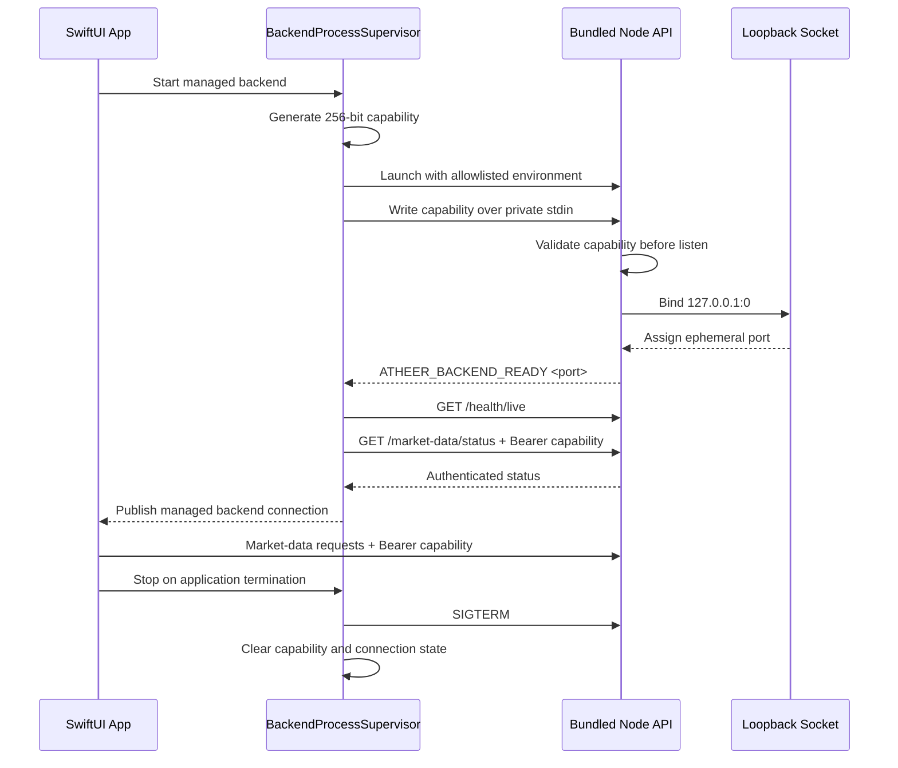

# SESSION 048 — Native macOS Backend Supervision and Authenticated IPC

**Date:** 2026-11-18  
**Branch:** `feat/macos-managed-backend-runtime`  
**Parent:** PR #52 head `550c28b0fd107cc474ad52065a30e75c2ed84eee`  
**Scope:** ATP-BRK-002 / EDL-025 — native process supervision and authenticated market-data transport

## Delivered implementation

- Added `BackendProcessSupervisor` to resolve the packaged backend runtime, generate a cryptographically random 256-bit capability with `SecRandomCopyBytes`, launch the child process, and send the capability through private stdin.
- The child receives only an allowlisted environment: loopback host, ephemeral port, production Node mode, and `CAP_ALLOW_TRADING=false`. Broker credentials are not inherited from the parent environment.
- The supervisor consumes the backend's `ATHEER_BACKEND_READY <port>` marker, probes `/health/live`, and then probes `/market-data/status` with the Bearer capability before publishing the connection.
- The supervisor handles startup timeout, child termination, stale termination callbacks, capability clearing, and app shutdown.
- `URLSessionMarketSearchClient` now requires the managed connection and attaches the Bearer capability to every market-data request. The unauthenticated default client path has been removed.
- `BackendHealthClient` now accepts the OS-assigned backend URL.
- The application composition root starts the backend and exposes a truthful retry/diagnostics state if the runtime is missing or startup fails.
- App termination requests a controlled child-process stop.

## Runtime packaging

- Pinned the build/runtime Node version to **24.22.3**.
- The packaging script downloads the official macOS x64 and arm64 archives, verifies both against pinned SHA-256 digests, creates a universal Node executable with `lipo`, includes the Node license, and packages the compiled API into the app resources.
- XcodeGen now includes the generated `Backend` and `Runtime` resource folders.
- `make generate` packages the backend before generating the Xcode project; macOS CI performs the same step.
- Node.js 24 official macOS binaries require macOS 13.5 or later. The app's deployment target remains 13.0, but the supervisor fails explicitly on systems older than 13.5 rather than attempting an unsupported child runtime. The owner Mac version previously recorded as 13.7.8 satisfies this runtime floor.

## Process and IPC lifecycle

## Library workflow alignment

The Q&A archive's Mermaid workflows for manual intervention, manual-override authority, execution uncertainty, and emergency recovery remain governing constraints. A backend restart or successful process probe does not establish broker-account recovery. Any future financial action must still pass authority checks, the central Risk Engine, OMS, Execution Gateway, and broker reconciliation. An uncertain broker outcome must not trigger an automatic duplicate submission.

## Verification added

- Swift unit tests cover canonical 256-bit base64url capability formatting, capability clearing, and strict readiness-port parsing.
- Existing Market Search HTTP tests now assert the Bearer header is attached to status and instrument-search requests.
- Added a backend child-process integration test that bootstraps through stdin, binds an ephemeral loopback port, verifies health, rejects unauthenticated market-data access, and accepts the correct capability.
- Hosted exact-head CI and macOS runtime qualification remain pending. No local Xcode build or owner-Mac launch is claimed.

## Explicitly not completed

- No Capital.com credentials are handed from Keychain to the backend yet.
- The existing native broker-management authentication path and environment-driven backend runtime still represent separate session authorities. The backend process currently starts without credentials and truthfully reports `not_configured`; Market Explorer remains unavailable until the single backend Broker Session Manager and Keychain handoff are implemented.
- No real Capital.com DEMO session, order submission, dealing endpoint, or LIVE behavior was exercised.
- Trading remains disabled.

## Next implementation increment

Implement the backend-owned Broker Session Manager and credential lifecycle: Keychain-backed retrieval in the macOS parent, authenticated local credential handoff with bounded request handling and redaction, one session authority for market data/streaming/account state, and deterministic connect/disconnect/reconnect/account-switch tests. Do not enable dealing routes as part of that work.
