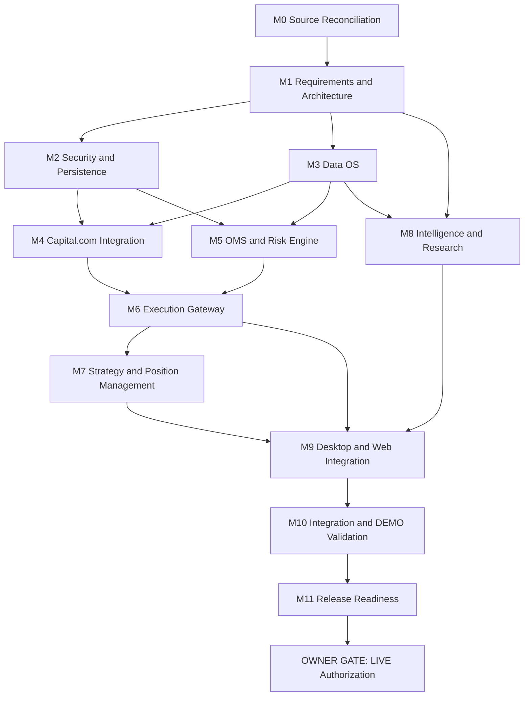

# ATHEER Trading Pro — Product and Engineering Roadmap

**Document ID:** ATP-ROADMAP-001  
**Version:** 0.1.0  
**Date:** 2026-11-18  
**Status:** Working engineering roadmap derived from the Library vision and architecture baseline; delivery sequence is evidence-driven and subject to refinement.  
**Tracking:** [ATP-ENG-063](https://github.com/atheertrading/atheer-trading-platform/issues/77) · [12-screen IPDS plan](https://github.com/atheertrading/atheer-trading-platform/issues/72)

## 1. Product thesis

ATHEER Trading Pro is a professional, extensible, multi-asset Trading Operating System. It is not merely a charting terminal, a broker-specific front end, or an AI chat interface.

The system connects:

- Market intelligence and broker-verified instrument data.
- Quantitative research, analytics and charting.
- Strategy engineering, deterministic simulation and backtesting.
- Manual and automated trading through one governed order path.
- Central risk authorization, OMS, execution and position management.
- Broker-state reconciliation, auditability and operational controls.
- Atheer Mind OS and specialized agents as bounded decision-support capabilities.
- A professional, configurable macOS workstation, with web and multi-user capability as later horizons.

Capital.com is the initial primary broker integration. The platform domain must remain broker-neutral so future adapters can be added without redesigning strategy, risk, OMS or UI contracts.

Potential asset classes include FX, metals, energy, indices, equities, digital assets and agricultural commodities. This list describes the platform domain, not guaranteed availability from any broker. An instrument may be shown as tradable only after its availability, account/jurisdiction eligibility, market-data entitlement, contract specifications and order capabilities are verified from authoritative provider data.

## 2. Product principles

1. **Capital preservation and trader authority:** financial safety is a system property, not a UI preference.
2. **Broker truth:** broker-confirmed orders, fills, positions, balances and margin are authoritative for broker-connected activity.
3. **One governed order path:** manual, strategy and AI-generated proposals converge on the same OrderIntent and risk/OMS/Execution Gateway path.
4. **No fabricated financial state:** never synthesize quotes, balances, margin, positions, fills or execution status.
5. **Environment isolation:** DEMO, SIMULATION, BACKTEST and LIVE have separate configuration, persistence, authorization and reporting.
6. **Deterministic safety:** hard financial constraints and risk decisions are deterministic; AI cannot authorize its own actions.
7. **Modular extensibility:** provider-neutral domain contracts, broker adapters, dependency inversion and explicit capability models.
8. **Evidence-driven delivery:** every milestone requires artifacts, acceptance criteria, tests, resolved dependencies and archived evidence.

## 3. Target domain architecture

| Domain | Responsibility | Required boundary |
|---|---|---|
| Data OS / Market Intelligence | Provider ingestion, normalization, provenance, freshness, replay, gaps and subscriptions | Provider DTOs do not leak into UI, risk or strategy |
| Instrument Registry / BIDCMS | Canonical instrument identity, asset class, broker availability and contract specifications | Tradability is account/provider capability-qualified |
| Quantitative Research | Indicators, features, charting, historical datasets and research | Deterministic calculations and reproducible inputs |
| Strategy OS | Strategy definitions, versions, lifecycle and signal generation | Strategies emit intents; they do not deal directly |
| Risk & Portfolio | Pre-trade controls, exposure, margin, concentration, limits and emergency policy | Independent authorization; fail closed on unknown/stale state |
| OMS | Durable order state machine, idempotency, fills, cancel/replace and reconciliation | Broker acknowledgement is not a fill |
| Execution Gateway | The only broker-dealing boundary | Rejects absent/expired/invalid risk authorization |
| Position Management | Broker-sourced positions, protective actions and lifecycle monitoring | Local state is reconciled projection, not broker truth |
| Atheer Mind OS / Agent OS | Research, analysis, explanation, proposals and bounded workflows | No broker secrets, self-authorized risk or direct dealing |
| Workstation & Operations | Navigation, workspaces, charts, controls, audit and observability | UI cannot bypass backend governance |
| Identity & Tenant Services | User identity, authorization, isolation and later team/organization support | User, broker account, trading account and tenant are distinct |

## 4. Strategic horizons

These horizons operationalize the Library's three-to-five-year vision. They are strategic outcomes, not fixed release dates.

### Horizon 1 — Professional core

Establish a dependable owner-managed workstation with verified broker connectivity, multi-asset instrument discovery, reliable live/historical market data, charting, manual DEMO trading, centralized RiskEngine, OMS, Execution Gateway, position management, strategy development and historical backtesting.

**Outcome:** a professionally integrated DEMO-capable trading workstation with a complete and reconciled order lifecycle.

### Horizon 2 — Intelligence ecosystem

Add Atheer Mind OS, Agent OS, Skill OS, quantitative research, market-regime and volatility analysis, news/economic-event intelligence, advanced strategy validation and continuous position intelligence.

**Outcome:** AI-assisted decision intelligence with auditable evidence and bounded permissions, never a parallel execution authority.

### Horizon 3 — Scalable infrastructure

Introduce multi-user identity, role/permission controls, isolated workspaces, independent broker connections, expanded broker adapters, portfolio management, resource governance and resilient service deployment.

**Outcome:** independent users and trading environments supported without architectural redesign.

### Horizon 4 — Professional and institutional capabilities

Add organizational/team workspaces, cross-strategy exposure and correlation, advanced portfolio intelligence, institutional reporting/audit and more sophisticated automation governance where validated demand justifies it.

### Horizon 5 — Integrated ecosystem

Consolidate broker-independent trading infrastructure, modular analytical/algorithmic capabilities, model-provider extensibility, organizational capabilities and a governed developer/strategy integration ecosystem.

## 5. Engineering milestones and dependency order

The following M0–M11 sequence follows the consolidated architecture's recommended implementation path.

| Milestone | Scope | Exit condition | Current evidence |
|---|---|---|---|
| **M0 — Source Reconciliation** | Authority, source inventory, conflicts, repository/Library continuity | Canonical sources and conflicts recorded; branch integration plan verified | Partial; ATP-ENG-063 remains open |
| **M1 — Requirements & Architecture** | Product requirements, domain boundaries, contracts, ADRs and acceptance criteria | Critical contracts and owners established; unresolved items explicitly registered | Architecture records exist; formal reconciliation/approval gaps remain |
| **M2 — Security & Persistence** | Identity/capability, secret custody, local IPC, durable store, audit and recovery | Threat model, Keychain lifecycle, authenticated IPC, migrations, backup/restore and security tests pass | UDS/capability work exists on PR #66; lifecycle qualification and durable trading persistence remain incomplete |
| **M3 — Data OS** | Market-data ingestion, provenance, normalization, freshness, replay, historical data and subscription governance | Deterministic quality/recovery tests; provider data provenance preserved | Streaming/history partial on open PRs; catalog/persistence/reconciliation remain |
| **M4 — Capital.com Integration** | DEMO session, instrument discovery, market navigation, REST/WebSocket and broker capabilities | Official contract verified; account/instrument capabilities qualified; reconnect/keepalive and data soak pass | Read-only DEMO REST/stream/history on open PRs; no end-to-end account runtime evidence |
| **M5 — OMS & Risk Engine** | Canonical order domain, intent journal, risk policies and OMS state machine | Manual/strategy/AI intents share one fail-closed path; idempotency and durable state verified | Not implemented in reviewed source |
| **M6 — Execution Gateway** | Controlled broker dealing, confirmation, retry and reconciliation | Only authorized OMS commands reach broker; ambiguous outcomes reconciled before retry | Not implemented in reviewed source |
| **M7 — Strategy & Position Management** | Strategy lifecycle, position monitoring, protective actions and account/portfolio projections | Deterministic strategy lifecycle and broker-reconciled position controls pass | Not implemented in reviewed source |
| **M8 — Intelligence & Research** | Quant research, backtesting, AI agents, model gateway and market intelligence | Reproducible research; agent permissions/audit; no execution bypass | Architecture direction exists; implementation not verified |
| **M9 — Desktop & Web Integration** | 12-screen IPDS, macOS workspace, accessibility, RTL and future web client | Screen contracts, automated tests, native visual/accessibility/RTL QA | macOS shell/chart and IPDS foundation are on separate open PRs; screen blueprint is proposed |
| **M10 — Integration & DEMO Validation** | End-to-end broker/data/risk/OMS/execution/position reconciliation and soak | Complete DEMO lifecycle, failure/restart/reconciliation evidence and rollback | Not achieved |
| **M11 — Release Readiness** | Packaging, signing, security review, SLOs, recovery, release evidence | All release gates pass and owner release decision is recorded | Not started |

### Critical path

Source reconciliation → Requirements closure → Architecture → Security and persistence → Market data and broker integration → RiskEngine and OMS → Execution Gateway → Position Management → End-to-end DEMO validation → Release readiness.

Strategy research, UI design, historical testing and AI can proceed in parallel when their dependencies are satisfied. None can establish an independent execution capability.

## 6. DEMO trading vertical slice — mandatory product acceptance

The first functional trading milestone is not a collection of isolated order buttons. It is one end-to-end, broker-reconciled vertical slice:

`Manual / Strategy / AI Proposal → OrderIntent → Identity & Domain Validation → Central RiskEngine → OMS → Execution Gateway → Capital.com DEMO Adapter → Broker Confirmation → Reconciliation → Position Projection`

Minimum acceptance:

- Canonical `Account`, `Instrument`, `OrderIntent`, `Order`, `Fill`, `Position` and `ExecutionReport` contracts.
- Durable intent journal/outbox, UUID/correlation IDs, idempotency and append-only audit.
- Risk checks for account state, instrument capabilities, market status, quote freshness, exposure, margin, order size, price bounds and strategy/user limits.
- Broker acknowledgement separated from execution confirmation; use the broker deal reference and confirmation endpoint.
- Timeout/unknown result treated as ambiguous; reconcile before retry.
- Partial fills, reject, cancel/replace, disconnect, restart and duplicate submission tested.
- Manual, strategy and AI proposals use exactly the same risk and execution path.
- Emergency halt, cancel-pending and controlled close workflows are tested against verified broker state.
- DEMO and SIM/BACKTEST remain isolated; no LIVE route is enabled by default.

## 7. Multi-asset and multi-broker requirements

A platform-level instrument must not be a raw broker epic. The canonical registry must model at least:

- Stable platform instrument identity and provider-specific identifiers.
- Asset class, underlying, quote/base currencies and contract multiplier.
- Tick size, lot/quantity increments, minimum/maximum size and precision.
- Trading sessions, holidays, market status and data entitlements.
- Margin/leverage, financing, overnight fees and applicable risk semantics.
- Supported order types, time-in-force, stop/limit behavior and modification capabilities.
- Broker/account/jurisdiction availability and verification timestamp.
- Price source, provider timestamp, receipt timestamp and quality state.

Broker subscription caps must be handled by a scheduler with priority, capacity telemetry and explicit degraded states. A provider's current 40-instrument stream cap is a broker constraint, not the platform's total instrument limit.

## 8. AI and automation governance

- Atheer Mind OS coordinates decision intelligence; Agent OS governs specialized agents; Skill OS provides reusable capabilities; Algorithm OS owns deterministic calculations; Data OS owns verified data; Strategy OS owns strategy lifecycle; Model Gateway isolates model providers.
- AI may research, analyze, explain, rank and propose intents.
- Agents may operate only within explicit permission profiles and auditable scopes.
- No agent or strategy may hold broker credentials, call dealing endpoints directly, authorize its own risk, change risk limits or expand its permissions.
- RiskEngine and OMS remain deterministic and authoritative.
- Every proposal must carry source evidence, timestamp, identity, uncertainty/confidence and expiry.

## 9. Workstation and IPDS roadmap

Issue #72 governs the 12-screen inventory. Its delivery groups are:

1. Application Shell and Navigation.
2. Command Center.
3. Markets.
4. Charts and Analysis.
5. Trading + Risk + Positions — only after domain/governance gates, DEMO qualification only.
6. Remaining areas: Intelligence and Research, Strategy Center, Automated Trading, Performance and Analytics, Atheer Mind OS, and System and Administration.

The screen blueprint remains the canonical source for the exact 12-screen inventory; this roadmap preserves the issue's delivery grouping rather than duplicating an incomplete screen list.

Cross-cutting requirements: dark-first, adaptive density, Light/Dark semantic tokens, Arabic RTL, keyboard/accessibility, operational states, responsive panels, visual QA and no fabricated financial values.

The corrected UI-only estimate is 85–140 engineer-days. It excludes backend/domain implementation, broker qualification, owner-review latency and release certification. Re-estimate after Shell, Command Center and Markets have been implemented and measured.

## 10. Current integration baseline — 2026-11-18

- `main`: `31e3e5547c9204645427ec56426e741d4bcfa955`.
- Broker/chart stack: PR #51, #52, #53, #56, #55, #64, #66, #67, #68, #70. No PR in this chain is merged.
- PR #51 is 20 ahead / 4 behind main; the immediate child branches from #52 through #70 are aligned to their declared parents.
- PR #52 and #53 are Draft due incomplete/failed qualification; PR #57 is closed as superseded by #66.
- PR #69 (IPDS foundation) is 6 ahead / 0 behind main; PR #73 (screen blueprint) is 10 ahead / 0 behind #69.
- PR #70 is 422 ahead / 10 behind #69. Shared Swift files and Mermaid identifiers require integration.
- Current source implementation is read-only Capital.com DEMO market data and historical charting on open branches. The trading core (RiskEngine, OMS, Execution Gateway, broker dealing, positions and reconciliation) is not implemented in the reviewed branch set.
- Exact-head CI, owner-Mac build/runtime, Keychain restart and actual DEMO authentication are not complete.

## 11. Milestone closure policy

A milestone cannot close unless:

- Mandatory deliverables exist.
- Acceptance criteria are satisfied.
- Required deterministic tests and exact-head CI pass.
- Known limitations are recorded.
- Dependencies are resolved or formally dispositioned.
- Security and risk reviews are complete where applicable.
- Evidence is archived and traceable to exact commits.
- Required approval is recorded.

## 12. Explicit non-goals and owner gates

- This roadmap does not authorize LIVE dealing, production deployment, changes to risk limits or broker-account permissions.
- `CAP_ALLOW_TRADING=false` remains the default until DEMO reconciliation and RiskEngine/Execution Gateway validation are complete.
- LIVE activation remains a separate explicit Owner Gate after M11 release readiness.
- No milestone may weaken mandatory security, risk, audit or environment-isolation controls.

---

## 13. Re-audit addendum — 2026-11-18 23:15 Cairo

This addendum supersedes the implementation snapshot in Section 10 where newer exact-head PR evidence is available. The original snapshot is retained for historical traceability.

### 13.1 Current repository and merge state

- Canonical repository: `atheertrading/atheer-trading-platform`.
- Default branch: `main`; latest verified integration baseline remains `31e3e5547c9204645427ec56426e741d4bcfa955`.
- No PR in the reviewed delivery stacks has been merged to `main`.
- All current PR heads below are feature-branch evidence, not integrated `main` functionality.

### 13.2 Updated domain, persistence, risk and OMS progress

| Workstream | Current PR evidence | Verified scope boundary |
|---|---|---|
| Canonical multi-asset domain | #76 — `f1d3e60fde2b9021d65adcda7f8d338bdcd412cd` | Provider-neutral account/instrument/order-intent/risk/execution/reconciliation contracts and deterministic domain validation. No runtime API, persistence, RiskEngine, OMS or dealing. |
| PostgreSQL persistence | #81 — `f31ec142ac59476ea083e88ee7162ef0701fc438` | Explicit checksum-verified migrations, environment-scoped records, durable intent/risk/audit/reconciliation journals and transactional domain-event outbox. No outbox dispatcher or execution worker. |
| OMS lifecycle persistence | #82 — `b8a465f7a80dd1ca96f9f213977f2caa97b4fdf8` | Persists order and initial lifecycle/audit/domain event atomically, requiring the exact immutable intent and matching persisted `AUTHORIZED` RiskAssessment. No broker dispatcher, Execution Gateway or dealing. |
| Pre-trade RiskEngine | #86 — `fde3450dba0334a1fcafc92b2260a6159e2563ca` | Deterministic policy-driven evaluator with `AUTHORIZED`, `REJECTED`, `HELD`, injected policy/context/control interfaces, provenance/freshness checks and exact-decimal validation. No HTTP route, runtime policy/context adapters, valuation service, persisted assessment adapter, OMS wiring or dealing. |

The current backend dependency shape is `#76 → #81 → #82`, with `#86` based on #81. These are separate unmerged branches. #82's persistence contract and #86's evaluator must be reconciled against the same immutable assessment schema and exact intent binding before integration. A pure evaluator and an OMS persistence adapter do not together establish an operational order path.

### 13.3 Updated workstation and market-data progress

| Workstream | Current PR evidence | Verified scope boundary |
|---|---|---|
| IPDS foundation | #69 — `fa195a6e0617091322b7934564db0e681cd9d58d` | Adaptive semantic Dark/Light tokens and persisted appearance preference. The #00CEC8 versus Q&A Q39.1 #40E0D0 brand-turquoise conflict remains unresolved; do not silently choose a new canonical value. |
| 12-screen blueprint | #73 — `6591283c8d9568e17c5e9bb328f43dfcd2ccf7b1` | Design blueprint and delivery plan; the 12-screen inventory is a target, not 12 implemented screens. |
| Operational status strip | #80 — `9fd6e3aaa6af82eba55e01c512200cee6956bd01` | Separates API liveness, platform readiness and trading gate in the shell; presentation-only. |
| Historical chart workspace | #70 — `031c88e73d7a172601138aea8904371a0f630a02` | Authenticated read-only DEMO historical charting; no live candle aggregation, indicators, drawing tools or dealing. |
| Persistent DEMO Market Watch | #83 — `abf87d40c866a2b6ef7efffbd1b8d7186165f095` | Shared stream lifecycle and provider-backed quote presentation; account values remain unavailable without an authenticated account read model; no dealing. |
| Instrument quick search | #85 — `326214b20dd2bdebd8d7e171bf8cf6aafbe12922` | Keyboard-accessible catalogue discovery using existing authenticated read-only search; no execution controls. |

The UI/chart branches overlap in `ContentView.swift`, `MarketExplorerView.swift`, workspace composition and test files. The IPDS/chart stacks also contain Mermaid numbering collisions. Integration requires a deliberate source and diagram reconciliation, not a merge based only on GitHub's mergeable flag.

### 13.4 Exact-head qualification status at this review

- #76: Backend toolchain and repository hygiene passed; both macOS architecture jobs were cancelled. Its CI run is incomplete, not a source failure.
- #81: Backend toolchain and repository hygiene passed; Intel qualification was in progress and Apple Silicon had been cancelled at inspection.
- #82: Backend toolchain and repository hygiene passed; Intel was queued and Apple Silicon had been cancelled at inspection.
- #86: Repository hygiene and Mermaid passed; Backend and Intel qualification were in progress/queued and Apple Silicon was queued at inspection.
- #69, #80 and #85: targeted CI workflows were queued for retry after earlier cancelled macOS jobs. No retry result is claimed here.
- #70 and #83: inspected runs had cancelled macOS/backend jobs; neither is fully qualified.
- #78: the earlier roadmap/documentation workflow had cancelled jobs; this addendum itself must pass exact-head CI after commit.

A completed pass is valid only for the exact commit and architecture tested. Cancellation is neither pass nor proof of a code defect. Hosted CI does not replace owner-workstation Xcode 14.3.1, native launch, visual/accessibility/RTL, Keychain restart, PostgreSQL backup/restore or authenticated broker-runtime qualification.

### 13.5 Reconciled milestone status

| Milestone | Updated status | Remaining exit evidence |
|---|---|---|
| M0 — Source Reconciliation | Partial | Library/Q&A/archive provenance, current source conflicts, stale main continuity and full PR ancestry still require reconciliation. |
| M1 — Requirements & Architecture | Partial | Canonical domain and architecture records exist on feature branches; cross-contract review and accepted decision/traceability closure remain. |
| M2 — Security & Persistence | Partial | Authenticated IPC and PostgreSQL migration/persistence work exist on unmerged branches; full lifecycle, backup/restore and runtime qualification remain. |
| M3 — Data OS | Partial | Read-only streaming/history/chart increments exist on unmerged branches; provider-independent catalog, subscription governance, replay/gap recovery and complete data qualification remain. |
| M4 — Capital.com Integration | Partial | DEMO read-only market data/search/history exist on open branches; authenticated account read model, complete instrument capabilities, broker reconciliation and dealing qualification remain. |
| M5 — OMS & Risk Engine | Partial foundation | Domain contracts, persisted intent/risk records, OMS lifecycle persistence and a pure policy-driven RiskEngine exist on dependent branches; runtime adapters and integrated risk-to-OMS transaction remain. |
| M6 — Execution Gateway | Not implemented | Exclusive authorized dealing boundary, outbox dispatch, broker confirmation and reconciliation path. |
| M7 — Strategy & Position Management | Not implemented | Strategy lifecycle, position projections, broker-reconciled management and protective-action policy. |
| M8 — Intelligence & Research | Specified / implementation unverified | Model Gateway, agent permissions, quant research, reproducible backtesting and evaluation. |
| M9 — Desktop & Web Integration | Partial | Native shell, Markets, API Connection, Settings, chart/search/status increments; remaining screens, workspace lifecycle, accessibility, Arabic RTL and visual qualification. |
| M10 — Integration & DEMO Validation | Not achieved | Complete end-to-end DEMO order lifecycle, failure/restart/idempotency/reconciliation and controlled soak evidence. |
| M11 — Release Readiness | Not started | Signed distribution, security review, SLOs, recovery, release evidence and explicit release decision. |

### 13.6 Multi-asset, broker and AI architecture clarifications

- Separate **analytical support**, **market-data availability** and **trading availability**. Broker catalogue support determines whether that broker/account can trade an instrument; it must not define the platform's entire analytical universe.
- Maintain a canonical platform instrument identity and map each provider/broker identifier and capability to it. Do not use a raw Capital.com EPIC as the platform's canonical instrument identity.
- Do not label an instrument tradable until provider/account/jurisdiction availability, market-data entitlement, contract specifications, order capabilities and verification time are known.
- Preserve DEMO, SIMULATION, BACKTEST and LIVE as isolated environments.
- AI autonomy level and capability permissions are orthogonal. A3/A4 autonomy can only operate inside explicit, revocable, pre-authorized envelopes; agents cannot grant themselves permissions, change risk limits, authorize risk or call broker dealing endpoints.
- The five-year strategic direction remains: professional core; intelligence ecosystem; scalable multi-user infrastructure; professional/institutional capabilities; integrated broker-independent ecosystem. These are strategic horizons, not fixed release dates.

### 13.7 Documentation and diagram reconciliation

The current `main` README and engineering continuity/implementation/task snapshots still describe earlier PR #9/#10/#17/#18 and November 17 status. PR #78 contains a more recent documentation snapshot but remains stacked on the unqualified chart branch. The integration tracker Issue #77 received a separate re-audit comment on 2026-11-18; see its conversation for the exact PR heads and qualification details.

The Library contains the original Q&A repository and historical architecture archives. The historical Mermaid export contains 52 source diagrams; the GitHub diagram guide still records their reviewed extraction/commit migration as pending. Preserve original files and provenance. Keep canonical diagrams separate from historical exports, validate every committed `.mmd` in CI, and resolve diagram IDs 09–15 consistently before stack integration.

### 13.8 Local synchronization and safety

No local pull, checkout, branch switch, reset, stash, or workstation mutation was performed during this re-audit. Before local synchronization, inspect the owner's current worktree and preserve all staged, unstaged and untracked user changes. Use the repository's non-destructive sync procedure and fast-forward `main` only after the exact merge set is qualified.

`CAP_ALLOW_TRADING=false` remains unchanged. No broker dealing, LIVE permission, production deployment or release is authorized by this roadmap.
